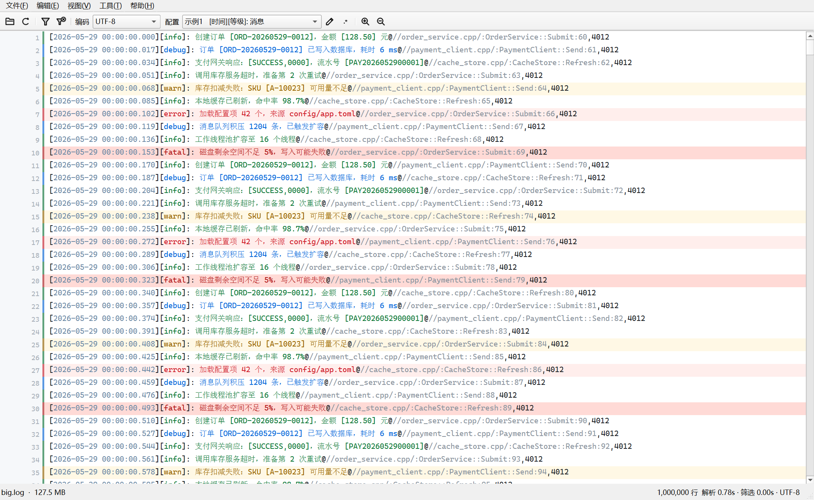
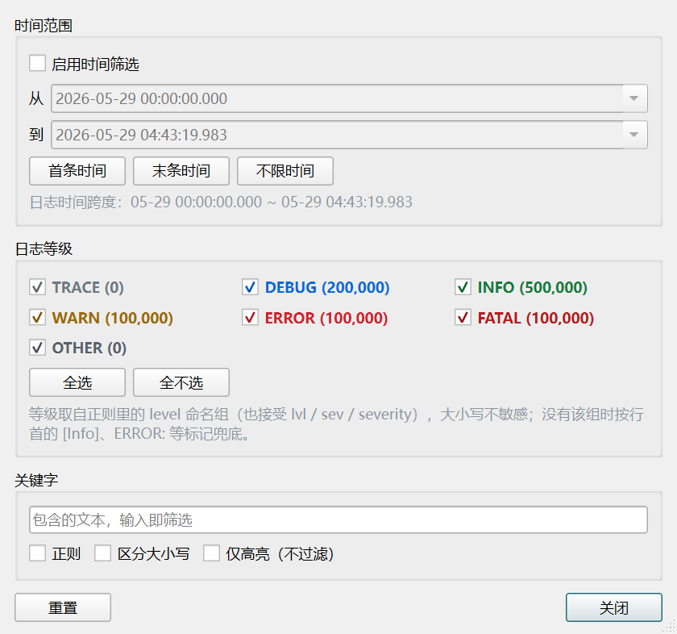
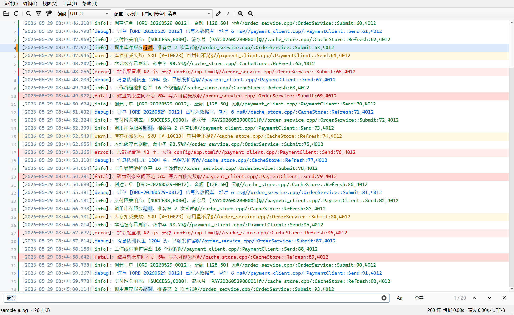
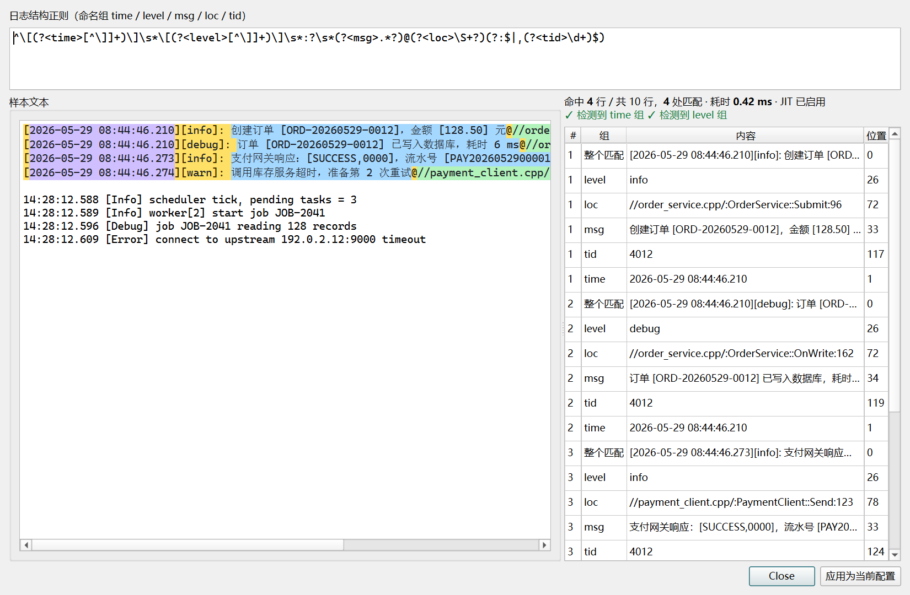
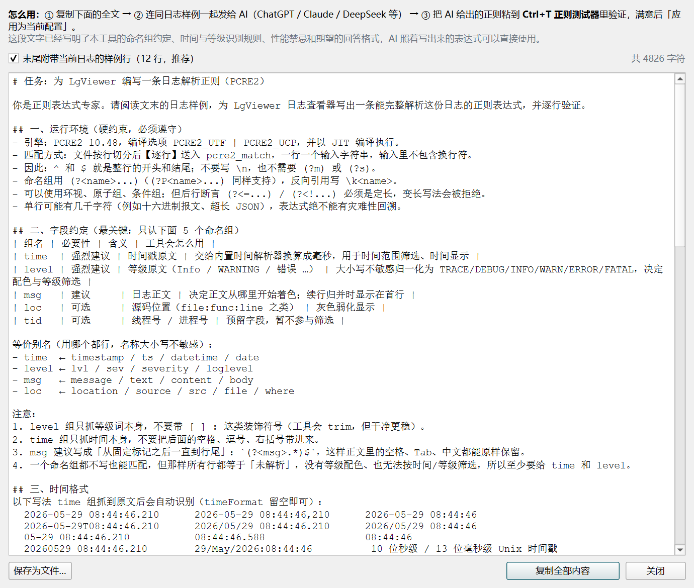

# LgViewer

跨平台的大文本日志查看器（Windows 优先，代码保持可移植）。专为**百 MB 级日志秒开、滚动不卡顿**设计，通过 PCRE2 正则配置日志结构，支持等级配色、时间/等级/关键字筛选、编码自动识别，并内置「正则编写介绍」——一键把日志样例和格式约定复制给 AI，让它帮你写正则。



## 特性

| 特性 | 说明 |
|---|---|
| 大文件不卡顿 | mmap 内存映射 + 行索引 + 后台线程逐行解析 + 自绘虚拟化视图（只渲染可见行）。实测 104.6 MB / 112.5 万行：**解析 0.6s，组合筛选 0.035s** |
| 正则配置日志结构 | 命名捕获组约定（`time` / `level` / `msg` / `loc` / `tid`），内置 7 个常用配置，JSON 持久化，可增删改 |
| 等级颜色高亮 | INFO / DEBUG / WARN / ERROR / FATAL / TRACE 全套配色，大小写不敏感、支持中文等级与单字母缩写；源码位置灰色弱化 |
| 时间 / 等级 / 关键字筛选 | 时间范围（自动识别日志跨度，支持跨天回绕）、等级复选框、关键字（子串 / 正则 / 仅高亮），全部后台执行可取消 |
| 全文查找 | Ctrl+F 底部查找栏：区分大小写 / 全字匹配开关、命中计数「3 / 128」、F3 / Shift+F3 或 Enter / Shift+Enter 上下跳转、当前命中橙色高亮 + 行号栏标记。后台线程扫描（133 MB 搜 10 万处命中约 0.1s），结果跟随当前筛选 |
| 控件风格切换 | 「视图」菜单勾选后切换到 Qt 自带的 **Windows 原生控件风格**，取消则回到 **Fusion** 跨平台风格，选择会记住，重启生效 |
| 拖拽打开 | 把日志文件从资源管理器直接拖进窗口任意位置即可打开；拖入时窗口显示半透明提示层（文件名 / 大小 / 路径），拖入的正是当前文件则原地重新加载并保留滚动位置 |
| 编码识别 | BOM → UTF-8 严格校验 → GB18030 结构校验 → UTF-16 启发式，可手动强制 |
| 正则测试器 | Ctrl+T 实时匹配 + 分组结果表 + 样本高亮 + JIT 状态，可一键应用为当前配置 |
| 正则语法速查 | F1 打开 PCRE2 语法速查（贪婪、环视、命名组、日志常用片段、常见坑） |
| 让 AI 帮你写正则 | Ctrl+Shift+R 打开「正则编写介绍」：一份写明本工具全部约定的需求说明，自动附带当前日志的样例行，整段复制给 AI 即可 |

## 截图

| 筛选弹窗 | 查找栏 | 正则测试器 |
|---|---|---|
|  |  |  |

## 下载与运行

- 从 [Releases](https://github.com/taynpg/LgViewer/releases) 下载压缩包，解压后运行 `LgViewer.exe`，或直接把日志文件拖到 exe 上。
- 命令行：`LgViewer.exe <日志文件>`。
- 配置保存在 `%APPDATA%\LgViewer\patterns.json`，首次运行自动生成。

### 从源码构建（Windows / MSYS2 UCRT64）

```bash
pacman -S mingw-w64-ucrt-x86_64-qt6-base mingw-w64-ucrt-x86_64-pcre2
# 或安装完整工具链：
# pacman -S mingw-w64-ucrt-x86_64-toolchain mingw-w64-ucrt-x86_64-cmake mingw-w64-ucrt-x86_64-ninja

cmake -B build -G Ninja -DCMAKE_BUILD_TYPE=Release
cmake --build build
# 产物：build/bin/LgViewer.exe
```

### 从源码构建（Linux）

需要 Qt 6.4+（含 Widgets）与 PCRE2：

```bash
# Debian / Ubuntu
sudo apt install qt6-base-dev libpcre2-dev cmake ninja-build

cmake -B build -G Ninja -DCMAKE_BUILD_TYPE=Release
cmake --build build && ./build/bin/LgViewer
```

### 一键构建 + 打包 Windows 安装包

```bash
python tools/PackBuild.py                                      # 交互式
python tools/PackBuild.py --mark=release --clean --pack --yes   # 无人值守
```

依赖：MSYS2 UCRT64（Qt6 / PCRE2 / cmake / ninja）、`windeployqt`（随 Qt 提供）、
`clangPack`（可选，用于补齐 libstdc++ / libpcre2 等非 Qt 运行库）、[NSIS 3.x](https://nsis.sourceforge.io/)。

流程：cmake + ninja 构建 → `windeployqt` 部署 Qt → `clangPack` 补运行库 → 拷贝
`LICENSE` / `LICENSES/` → `makensis` 生成安装包。

| 产物 | 路径 |
|---|---|
| 免安装目录（可直接压缩分发） | `build-<mark>/bin/` |
| 安装包 | `build-<mark>/LgViewer-setup-x64-v<版本>-<mark>-<commit>.exe` |

安装包按用户级安装（不弹 UAC），默认装到 `%USERPROFILE%\LgViewer`，带桌面 / 开始菜单快捷方式
与「应用和功能」卸载项。版本号取自 `CMakeLists.txt` 的 `project(... VERSION ...)`，dev 构建
自动加 `-dev` 后缀（可用 `LgViewer.exe --version` 查看）。

可用环境变量覆盖默认工具位置：`QT_LIB_ROOT`（默认 `C:\msys64\ucrt64`）、`NSIS_HOME`、
`CLANG_PACK`。

## 使用速查

| 操作 | 快捷键 |
|---|---|
| 打开 / 重新加载 / 关闭文件 | Ctrl+O / F5 / —（也可把文件直接拖进窗口） |
| 查找 | Ctrl+F，下一个 / 上一个 F3 / Shift+F3（输入框内 Enter / Shift+Enter 同效），Esc 关闭 |
| 筛选条件（时间/等级/关键字） | Ctrl+Shift+F，清除 Ctrl+Alt+F |
| 正则测试器 / 语法速查 / 正则编写介绍 | Ctrl+T / F1 / Ctrl+Shift+R |
| 跳到行 / 回到开头 / 跳到末尾 | Ctrl+L / Ctrl+Home / Ctrl+End |
| 字号缩放 / 复制选中行 / 全选 | Ctrl+滚轮 / Ctrl+C / Ctrl+A |

高亮开关在 **视图 → 高亮显示**：等级关键字着色（默认开）、消息正文按等级着色（默认关）、WARN/ERROR 整行淡色底（默认开）。切换解析配置 / 重载 / 换编码时，视口位置自动保持。

## 正则约定

工具逐行匹配（输入不含换行符），通过命名捕获组识别字段：

| 组名 | 必要性 | 含义 |
|---|---|---|
| `time` | 强烈建议 | 时间戳原文，自动识别 `2026-05-29 08:44:46.210`、`14:28:12.588`、Unix 时间戳等常见写法；特殊格式可配 `timeFormat`（Qt 格式串） |
| `level` | 强烈建议 | 等级原文，大小写不敏感归一化（`Info`/`INFO`/`information` → INFO，`warn`/`WARNING`/`警告` → WARN …） |
| `msg` | 建议 | 日志正文 |
| `loc` | 可选 | 源码位置，灰色弱化 |
| `tid` | 可选 | 线程 / 进程号 |

别名等价：`lvl`/`sev`/`severity` → level，`message`/`text`/`body` → msg 等。未匹配上的行自动归并到上一条（续行），适合堆栈与多行报文。

写法示例（对应 `时间 [等级] 消息` 格式）：

```
^(?<time>\d{1,2}:\d{2}:\d{2}[.,]\d{3})\s+\[(?<level>[^\]]+)\]\s*(?<msg>.*)$
```

手写正则太慢？**Ctrl+Shift+R** 打开「正则编写介绍」，把全文连同日志样例复制给任意 AI，它会按上面的约定返回可直接使用的表达式，粘进 Ctrl+T 测试器验证后一键应用。



## 目录结构

```
src/          源码（C++17，Qt Widgets + PCRE2 C API）
resources/    应用图标 / .rc / .qrc
tools/        辅助脚本
testdata/     gen.py：测试日志生成器（含 GBK 样例与百万行压力文件）
tests/        正则引擎自检、图标预览等小工具
LICENSES/     LGPL-3.0-only.txt（Qt）、PCRE2-BSD-3-Clause.txt
docs/         截图
```

## 许可

- **LgViewer 自身代码**：[MIT](LICENSE)
- **Qt**：以**动态链接**方式使用 Qt 6 开源版，许可为 **LGPL v3**（[LICENSES/LGPL-3.0-only.txt](LICENSES/LGPL-3.0-only.txt)）。你可以用自行编译的 Qt 库替换随附的 DLL 而无需重新编译本程序；Qt 源码可从 [download.qt.io](https://download.qt.io/official_releases/qt/) 获取。程序内「帮助 → 关于 Qt」为 Qt 自带说明，「帮助 → 开源许可」提供完整 LGPL 文本与权利说明。
- **PCRE2**：BSD-3-Clause（含 PCRE2 二进制分发例外），见 [LICENSES/PCRE2-BSD-3-Clause.txt](LICENSES/PCRE2-BSD-3-Clause.txt)。
